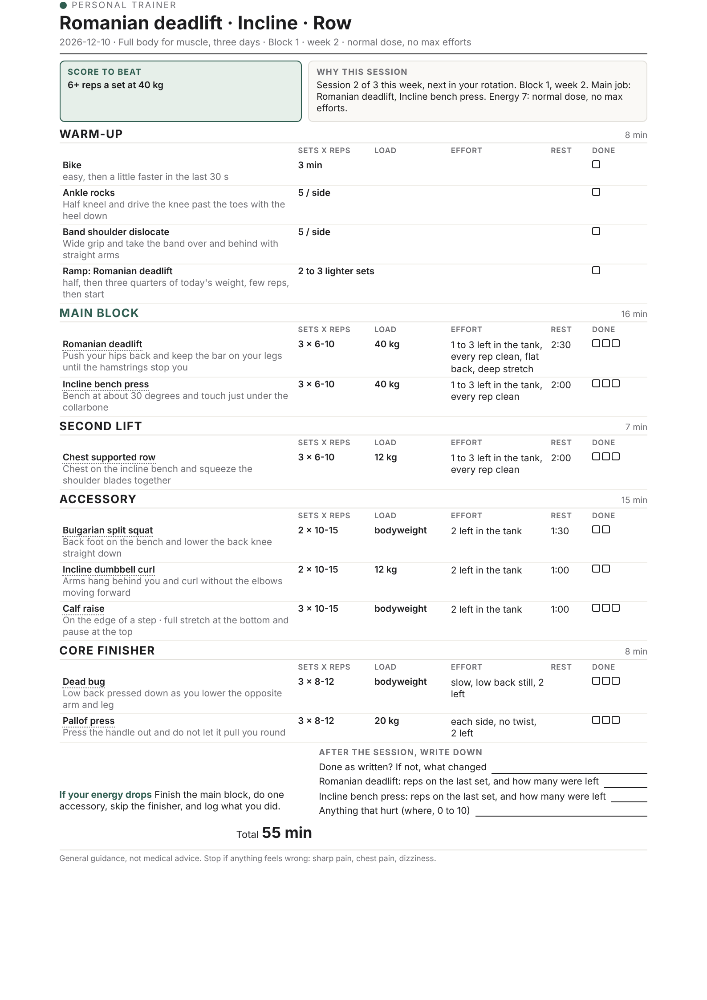
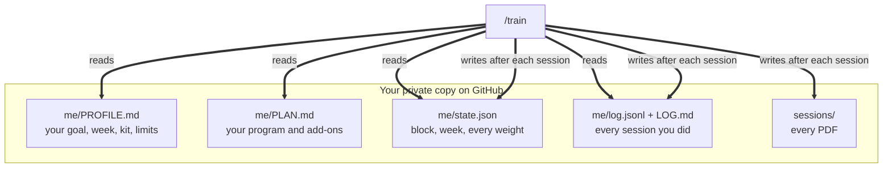

# Personal trainer

**A coach that learns what you want, picks a proven program with you, makes every session a one-page sheet, and remembers every rep.** It runs inside Claude Code and lives in your own private copy of this repository. No app, no account, no server.

<p align="center"></p>

## Get yours in three steps

**1 · Make your own copy.** Press the green **Use this template** button at the top of this page, then **Create a new repository**. Keep the name `personal-trainer` and choose **Private**. This copy is yours: your goals, your sessions and your log live in it and nowhere else.

**2 · Open it with Claude Code.** Pick one:

- **In your browser, nothing to install (easiest).** Go to [claude.ai/code](https://claude.ai/code), connect GitHub when it asks, and pick your `personal-trainer` repository.
- **On your computer.** Install four things once: Python 3 (Mac: already there or offered on first use · Windows: python.org, tick "Add python.exe to PATH"), Git (Mac: type `git` in Terminal and accept the prompt · Windows: "Git for Windows"), the GitHub CLI from [cli.github.com](https://cli.github.com), and Claude Code (Mac or Linux Terminal: `curl -fsSL https://claude.ai/install.sh | bash` · Windows PowerShell: `irm https://claude.ai/install.ps1 | iex`). Then:
  ```
  gh auth login
  gh repo clone YOUR-GITHUB-NAME/personal-trainer
  cd personal-trainer
  claude
  ```
  The first time, Claude Code asks you to log in and whether you trust this folder. Say yes.

**3 · Type `/train`.** It asks a few questions, picks a program with you, and makes your first session. After that: type `/train` before every workout, and tell it how it went afterwards.

**What you need:** a free GitHub account, and a Claude plan that includes Claude Code (the free plan does not, see [claude.com/pricing](https://claude.com/pricing)). The full guide, with what to do when something goes wrong: [`docs/SETUP.md`](docs/SETUP.md).

## How it works

```mermaid
flowchart LR
    A["You type /train"] ==> B{"First time?"}
    B == yes ==> C["Safety check<br/>12 quick items"]
    C ==> D["3 short rounds of questions<br/>goal · week and place · you"]
    D ==> E["The engine scores every program<br/>you pick from the top 3"]
    E ==> F["Your plan"]
    B == no ==> G["4 taps: energy · pain ·<br/>minutes · anything unusual"]
    F ==> G
    G ==> H["The engine builds today's session<br/>from your program and your last one"]
    H ==> I{{"Audits<br/>fresh reviewers check it"}}
    I ==> J["Your one-page PDF"]
    J ==> K["You train"]
    K ==> L["You say how it went,<br/>in any words"]
    L ==> M["Logged, weights moved,<br/>saved to your copy"]
    M ==> G
```



**The engine decides, Claude explains.** Picking the program, choosing exercises for your equipment, setting weights, progressing them, fitting the session into your minutes with every rest counted: all of that is code in `engine/`, reading the rules in `doctrine/`. Claude talks to you in your language, turns what you say into the engine's inputs, and puts the sheet in your words. That is why it does not make programs up.

**It picks objectively.** 24 programs built from the established schools of training (StrongLifts, Starting Strength, 5/3/1, GZCL, Reactive Training Systems, Renaissance Periodization, Nippard, PHUL, PHAT, CrossFit's methodology, HYROX plans, Viada, Couch to 5K, 80/20, Daniels, the r/bodyweightfitness routine, Overcoming Gravity, StrongFirst, the WHO and ACSM guidelines, and more). Every program is scored against your goal, experience, days, minutes, equipment, likes and limits by the same written rule, and you see why. The map of what each school prescribes and how strong its evidence is: [`doctrine/schools/INDEX.md`](doctrine/schools/INDEX.md).

**It remembers.** After every session it writes what you did into `me/` and saves it to your copy on GitHub, so it never forgets, on any computer or in the browser:



More pictures and every step in plain words: [`docs/HOW_IT_WORKS.md`](docs/HOW_IT_WORKS.md).

## What a week looks like

| when | you | it |
|:-|:-|:-|
| before training | `/train`, four taps | builds the session, checks it, sends the PDF |
| at the gym | follow the sheet, tick the boxes | |
| after | "done, squats felt heavy, last set 4 reps" | logs it, moves your weights, says what's next |
| any time | `/train week` | your week: done, left, and how much work each muscle got |
| any time | `/train goals` | changes your goal, days, place or limits and re-picks if needed |

## Safety and privacy

- It is **not a doctor**. A safety check comes first, and anything that needs a professional is sent to one. It never diagnoses, never trains through sharp pain, never writes a diet.
- **Your data stays in your copy.** The template you copied holds no one's data. While it works, your files are read by Claude like any Claude conversation; nothing is sent anywhere else. Keep your copy **Private**. To erase everything: `/train forget`.

## What's in here

| folder | what it is |
|:-|:-|
| `.claude/` | the `/train` skill, the six auditors, the permissions |
| `doctrine/` | the rules: safety, interview, matrix, intensity, loads, build, cycle, workflow, the 24 programs, the 10 add-ons, the 225 exercises, the schools |
| `engine/` | the code (Python, nothing to install): `plan.py` is the one entry point |
| `me/` | your memory (empty in the template) |
| `sessions/` | your sheets (empty in the template) |
| `docs/` | how it works, the setup guide |
| `research/` | the sources behind the rules |
| `tests/` | the proofs: `python3 tests/test_engine.py` and `python3 tests/smoke_programs.py` |
| `site/` | the share page |

Updates: `/train update` brings the newest rules and programs into your copy and never touches your data.
