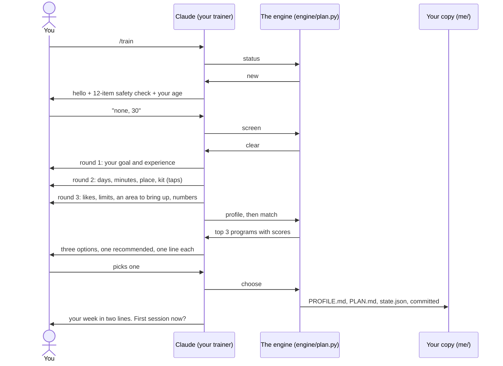
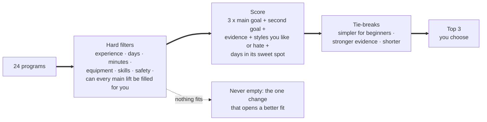
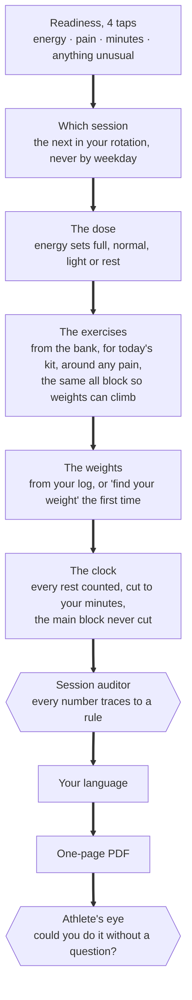
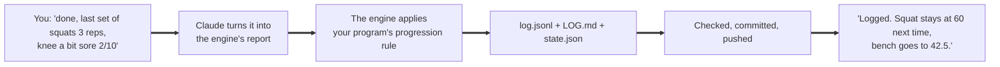

# How it works

_Every step, in plain words, with a picture. For the rules themselves, `TRAINER.md` names the file that owns each one._

## 1 · The first time

**What can stop it:** any of the first seven safety items (heart, chest pain, fainting, a long-term condition, its medication, a joint problem activity could worsen, a doctor's supervision order) means no program until a professional says yes. Pregnancy and diabetes with low-sugar risk need their midwife's or doctor's go-ahead. Under 18 is not served yet. The rules: `doctrine/01_SAFETY.md`.

## 2 · How the program is picked

The rule is written in `doctrine/03_MATRIX.md` and run by `engine/match.py`, and `tests/test_engine.py` proves the worked examples. A second goal never stacks a second program: it adds a module (a running add-on, conditioning, HYROX stations, skills, balance). Everyone 60 and over gets balance work.

## 3 · Every session

**Readiness lowers the dose, it never swaps the session.** Otherwise everyone ends up on the session they like. Four things do change the day: pain (that area is left out), being ill or wrecked (a rest day), different kit (swaps, or the travel session), and the spacing rule (no heavy legs within 24 hours of hard cardio).

## 4 · After the session

**The progression rules are code** (`engine/progress.py`), one per kind: linear (StrongLifts), double progression, 5/3/1 training-max waves, GZCLP stages, RPE top sets, bodyweight ladders, kettlebell timed standards, benchmark pieces, running volume, Couch to 5K weeks. The trainer never invents one.

**Weeks and blocks** close by themselves. A deload comes on schedule, or early if two warning signs show up (low energy three sessions out of four, a score dropping twice, sore or flat three times running).

## 5 · Who checks the work

Fresh reviewers (subagents in `.claude/agents/`) that see the files, never the trainer's reasoning:

| reviewer | when | checks |
|:-|:-|:-|
| school auditor | after picking a program | your profile says what you said, the safety rules held, the options were explained honestly |
| pick auditor | first sessions, new blocks, after pain | your energy and pain were read right |
| session auditor | every session | every exercise, number and rest traces to a rule |
| athlete's eye | first sessions, new blocks, after pain | you could do the sheet without a question |
| cycle auditor | end of a block, early deload | what improved, what stalled, whether the program still fits |

## 6 · Where your data lives

Only in your copy: `me/` and `sessions/`. The engine commits after every change and pushes to GitHub so your sheets are on your phone and nothing is lost. Keep the copy **Private**. `/train forget` explains how to erase it all (the only full erase is deleting the repository).
